<p align="center">
  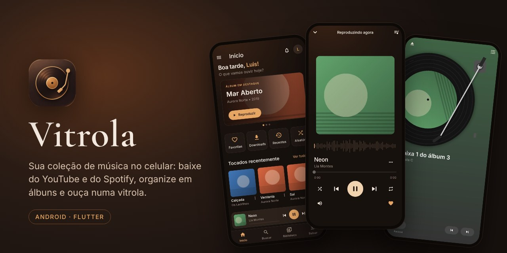
</p>

<p align="center">
  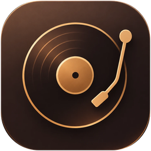<br>
  <b>Vitrola</b>: sua coleção de música no celular, do jeito que você gosta de ouvir.
</p>

<p align="center">
  <a href="../../releases/latest"><b>⬇️ Baixar o APK (Android)</b></a>
</p>

---

## Sobre

A **Vitrola** é um app de música para Android que monta a **sua própria biblioteca**, guardada no
celular. Cole (ou compartilhe) um link do **YouTube**, **YouTube Music** ou **Spotify**: a Vitrola
baixa o áudio, descobre **artista, álbum, ano, número da faixa, capa e informações da banda** e organiza
tudo em álbuns, artistas e playlists. Você também pode importar as músicas que já tem.

Para ouvir, tem tela bloqueada, notificação, fones Bluetooth, **Android Auto**, uma **vitrine 3D** ao
deitar o celular e a **Estante**, onde você escolhe um disco e o coloca numa vitrola.

## Telas

<table>
  <tr>
    <td align="center">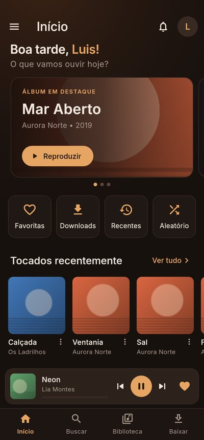<br><sub>Início</sub></td>
    <td align="center">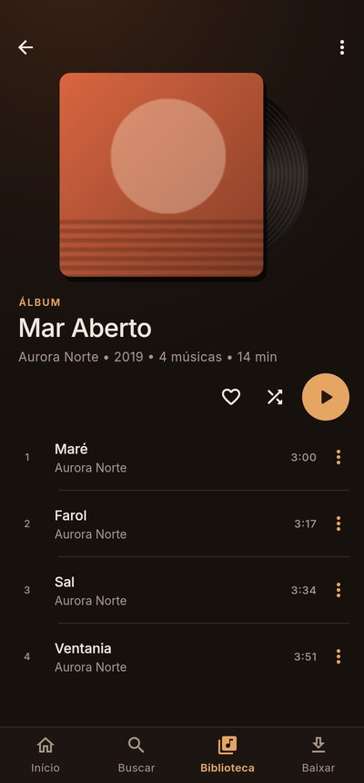<br><sub>Álbum</sub></td>
    <td align="center">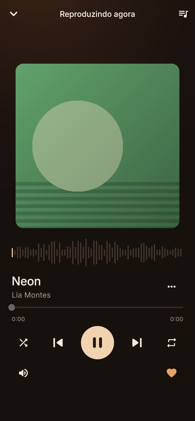<br><sub>Reproduzindo agora</sub></td>
  </tr>
  <tr>
    <td align="center">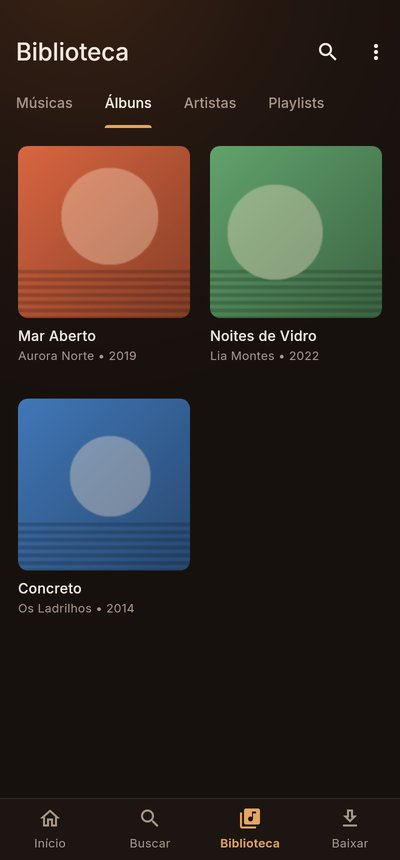<br><sub>Biblioteca</sub></td>
    <td align="center">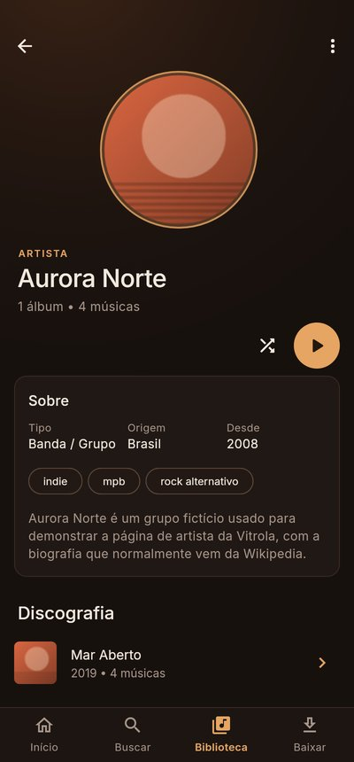<br><sub>Artista</sub></td>
    <td align="center">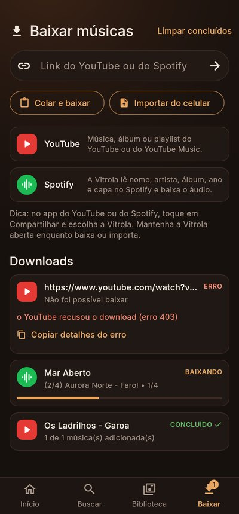<br><sub>Baixar músicas</sub></td>
  </tr>
  <tr>
    <td align="center">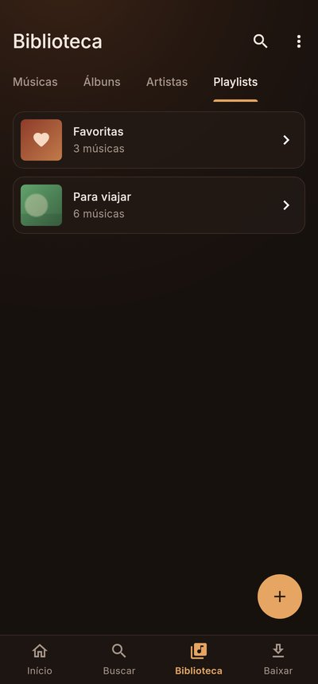<br><sub>Playlists</sub></td>
    <td align="center">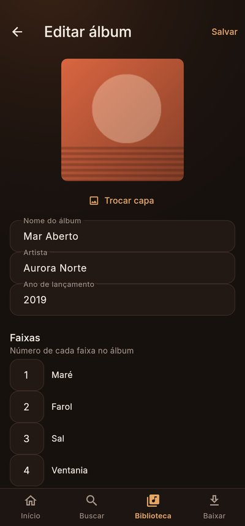<br><sub>Editar álbum</sub></td>
    <td align="center">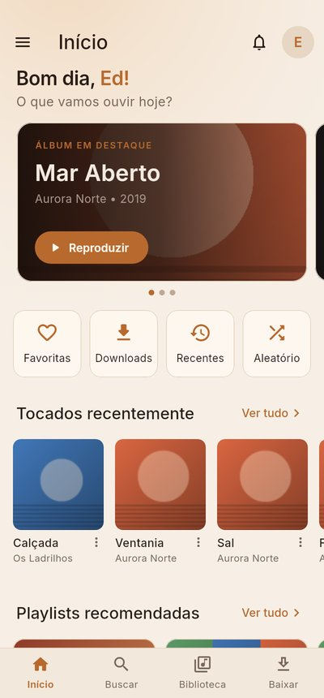<br><sub>Tema claro</sub></td>
  </tr>
</table>

### Estante

Escolha um álbum no cover flow e toque nele: a capa vai para o lado, o disco sai dela, pousa no prato,
o braço desce e a música começa. O fundo acompanha a cor da capa.

<table>
  <tr>
    <td align="center">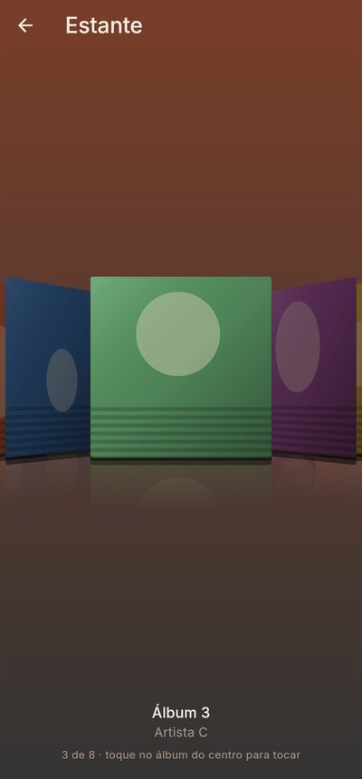<br><sub>Escolhendo o disco</sub></td>
    <td align="center">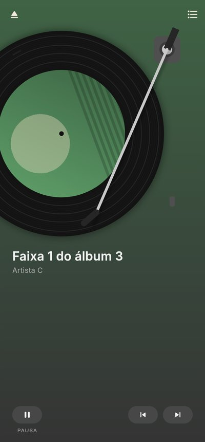<br><sub>Na vitrola</sub></td>
  </tr>
</table>
<p align="center">
  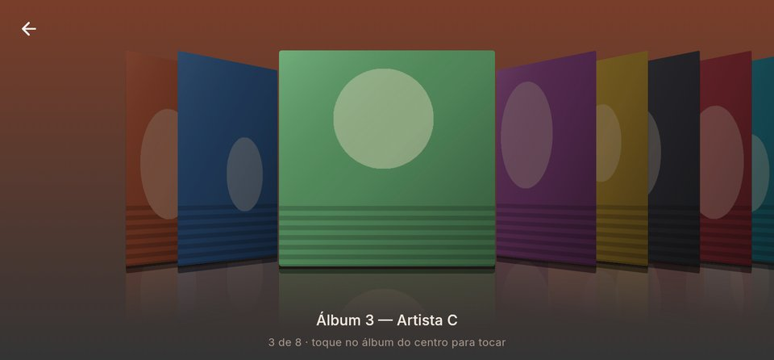
  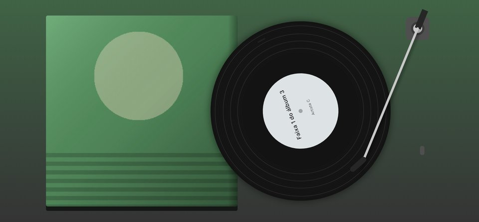<br>
  <sub>Deitado: cover flow e a vitrola em tela cheia</sub>
</p>

### Vitrine

Deite o celular em qualquer tela para ver seus álbuns lado a lado, em 3D, com o reprodutor embaixo.

<p align="center">
  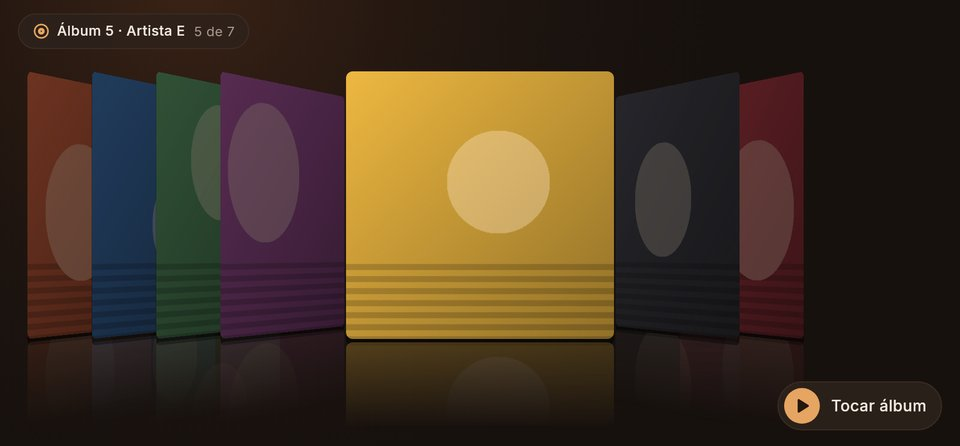
  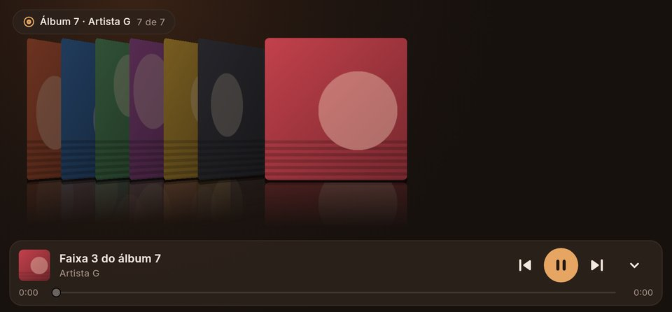
</p>

## Funções

**Baixar e organizar**
- 🔗 Baixa **música, álbum ou playlist** do YouTube, YouTube Music ou **Spotify** (do Spotify vêm os
  dados; o áudio da mesma música vem do YouTube).
- 📤 **Compartilhar → Vitrola**: direto do app do YouTube ou do Spotify.
- 📋 **Playlists do Spotify/YouTube viram playlists no app**, na mesma ordem, preenchidas enquanto baixa.
- 🏷️ Identificação automática: álbum, ano, nº da faixa, capa e biografia da banda (MusicBrainz, Cover
  Art Archive e Wikipedia).
- 📁 **Importar do celular**: MP3, M4A/AAC, FLAC, OGG/Opus e WAV, lendo as tags e a capa do arquivo.
- ✏️ **Editar** álbum (nome, artista, ano, números das faixas, capa) e músicas.
- ⚙️ **yt-dlp embutido**, atualizado sozinho uma vez por dia.

**Ouvir**
- ▶️ Fila, aleatório, repetir, tela cheia, notificação e tela bloqueada.
- 🚗 **Android Auto**: abas Início, Álbuns, Artistas e Playlists, busca por voz e botão de favoritar.
- 🔊 **Reforço de volume**, sem distorcer.
- ❤️ **Favoritas** e **mixes por gênero** (rock, MPB, indie, eletrônica…).
- 🕒 Tocadas recentemente e álbum em destaque na tela inicial.

**Visual**
- 🎨 Tema de madeira, cobre e âmbar, nos modos escuro e claro.
- 💿 **Vitrine 3D** ao deitar o celular.
- 📀 **Estante** com cover flow e vitrola animada, em pé e deitado, ótima também em tablets.

## Instalar

1. Baixe o `app-release.apk` na página de [**Releases**](../../releases/latest).
2. Abra o arquivo no celular. O Android vai pedir para **permitir instalar de fontes desconhecidas**
   para o navegador ou gerenciador de arquivos; permita e toque em **Instalar**.
3. Na primeira abertura, permita as **notificações** (para os controles na tela bloqueada).

> A Play Store não aceita apps que baixam do YouTube; por isso a instalação é pelo APK.
> Funciona em celulares ARM (praticamente todos), Android 7 ou mais novo.

### Android Auto

Por não vir da Play Store, ative a Vitrola no Android Auto uma vez: nas configurações do Android Auto,
toque 10 vezes em **Versão**, abra **⋮ → Configurações do desenvolvedor** e marque **Fontes desconhecidas**.

## Feito com

[Flutter](https://flutter.dev) · [just_audio](https://pub.dev/packages/just_audio) ·
[audio_service](https://pub.dev/packages/audio_service) · [sqflite](https://pub.dev/packages/sqflite) ·
[youtubedl-android](https://github.com/JunkFood02/youtubedl-android) (yt-dlp) ·
[MusicBrainz](https://musicbrainz.org) · [Cover Art Archive](https://coverartarchive.org)

## Compilar você mesmo (Windows)

Você só faz isso uma vez; depois é só repetir os passos 4 e 5 quando houver atualização.

1. **Instale o Flutter**: https://docs.flutter.dev/get-started/install/windows/mobile
   (baixe o .zip, extraia em `C:\src\flutter` e adicione `C:\src\flutter\bin` ao PATH).
2. **Instale o Android Studio**: https://developer.android.com/studio. Abra uma vez e deixe ele
   instalar o Android SDK. Depois, num terminal novo:
   ```
   flutter doctor --android-licenses
   flutter doctor
   ```
   Aceite as licenças. O `flutter doctor` deve mostrar ✓ em "Flutter" e "Android toolchain".
3. **No celular**: ative as Opções do desenvolvedor (Configurações → Sobre o telefone → toque 7 vezes
   em "Número da versão") e ligue a **Depuração USB**. Conecte o celular no PC pelo cabo e aceite
   o aviso que aparece no celular.
4. Na pasta deste projeto:
   ```
   flutter pub get
   flutter build apk --release
   ```
   O APK fica em `build\app\outputs\flutter-apk\app-release.apk`.
5. **Instale**:
   ```
   flutter install --release
   ```
   (ou copie o `app-release.apk` para o celular e abra o arquivo; o Android vai pedir para permitir
   instalar de fontes desconhecidas).

> Para testar com o celular conectado e ver os erros no terminal: `flutter run`.

## Configurações do app

Na tela Início, toque na engrenagem:

- **API do Spotify (opcional)**: sem ela, playlists do Spotify vêm com no máximo ~100 músicas.
  Crie um app grátis em https://developer.spotify.com/dashboard (marque “Web API”) e cole o
  Client ID e o Client Secret.
- **Completar informações pela internet**: desligue para usar só os dados do YouTube/Spotify.

## Onde ficam as músicas

Em `Android/data/app.vitrola.vitrola/files/Vitrola/musicas/Artista/Álbum/01 - Música.m4a`
(dá para ver pelo PC com o celular no cabo). A biblioteca e as playlists ficam no `vitrola.db`
na mesma pasta. **Se o app for desinstalado, essa pasta é apagada junto.**

## Limitações e problemas comuns

- **Mantenha o app aberto enquanto baixa.** Se você sair do app, o Android pode pausar o download.
  (Tocar música em segundo plano funciona normalmente.)
- **Primeira abertura do dia**: o app atualiza o yt-dlp (precisa de internet). O primeiro download
  espera essa atualização terminar.
- **O APK fica maior (~70 MB)** por causa do Python e do yt-dlp embutidos. Funciona em celulares
  ARM (praticamente todos), não em emuladores x86.
- **Os arquivos são M4A (AAC)**, direto do YouTube, sem conversão. Artista/álbum/capa ficam no banco
  da Vitrola, não gravados dentro do arquivo.
- **“o YouTube pediu verificação anti-robô”** ou **“erro 403”**: em Configurações, toque em
  **Atualizar yt-dlp agora** e tente de novo. Se continuar, espere algumas horas (o YouTube às vezes
  bloqueia por um tempo a rede/IP) ou tente pelo Wi-Fi em vez dos dados móveis (ou o contrário).
- **“vídeo com restrição de idade”**: o YouTube exige login para alguns vídeos e a Vitrola não faz
  login. Para links do Spotify ela já tenta o próximo vídeo encontrado; para links diretos, procure
  outro vídeo da mesma música (ex.: o do canal “Artista - Topic”).
- **Downloads pararam de funcionar de repente**: o YouTube muda com frequência. Em Configurações,
  toque em **Atualizar yt-dlp agora** (não precisa gerar outro APK).
- A Play Store não aceita apps que baixam do YouTube; por isso a instalação é pelo APK.

## Estrutura

```
lib/
  main.dart                 inicialização, abas, "Compartilhar → Vitrola"
  core/text.dart            limpeza de títulos e comparação de textos
  core/models.dart          modelos (música, álbum, artista, playlist, download)
  services/library.dart     banco SQLite
  services/youtube.dart     interface de acesso ao YouTube
  services/ytdlp.dart       yt-dlp embutido (canal com android/.../YtDlpBridge.kt)
  services/spotify.dart     links do Spotify (API oficial ou página pública)
  services/matcher.dart     identificação e escolha do vídeo certo
  services/metadata.dart    MusicBrainz, capas, Wikipedia
  services/importer.dart    importar músicas do celular (leitura das tags)
  services/downloader.dart  fila de downloads
  services/player.dart      player (just_audio)
  services/audio_handler.dart  notificação, tela de bloqueio e Android Auto (audio_service)
  ui/screens/shelf_screen.dart    vitrine de álbuns (celular deitado)
  ui/screens/estante_screen.dart  Estante: cover flow e vitrola animada
  ui/                       telas e componentes
android/.../CoverProvider.kt  capas para o Android Auto e a tela de bloqueio
test/                       testes (rodar com: flutter test)
```

## Aviso legal

Baixar conteúdo do YouTube pode violar os Termos de Serviço da plataforma, e baixar músicas protegidas
por direitos autorais sem autorização pode ser ilegal no seu país. Use a Vitrola para conteúdo que você
tem direito de baixar. O uso é de responsabilidade de quem utiliza.
